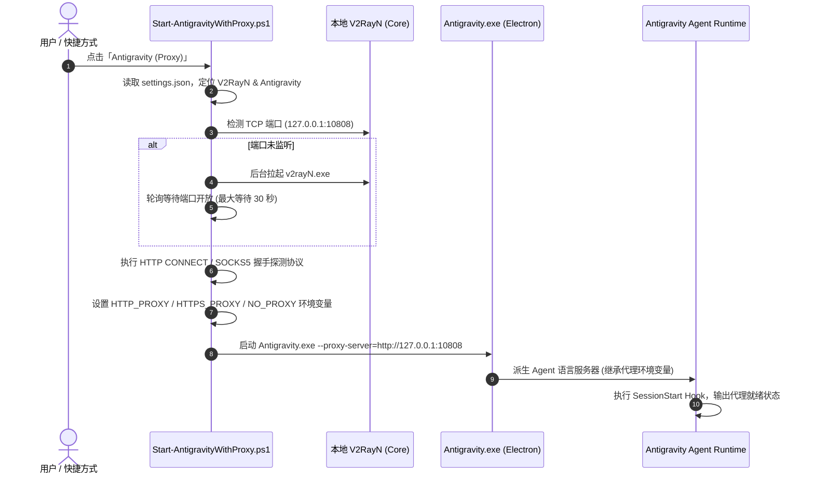

# Antigravity V2RayN Proxy Plugin (`v2rayn-proxy`)

[](https://www.microsoft.com/windows)
[](#)
[](https://github.com/2dust/v2rayN)
[](LICENSE)

为 **Google Antigravity** 量身定制的本地网络代理集成插件。彻底解决 Antigravity 启动时代理尚未就绪、无法连接模型服务、以及终端命令无法继承代理的问题。

---

## 🌟 核心功能

- **🚀 启动前自动拉起代理**：双击启动 Antigravity 前，自动嗅探 V2RayN 是否在运行；若未运行，自动在后台静默拉起 V2RayN 并轮询等待端口就绪后再启动客户端。
- **🔍 动态端口探测**：自动定位 V2RayN 安装目录并解析 `guiConfigs\guiNConfig.json` 中的入站配置，自动识别混合代理端口（默认 `10808`）或分离端口（`10808` / `10809`），无需手动硬编码端口。
- **🔌 双层代理通道注入**：
  - **客户端层 (Chromium/Electron)**：通过启动参数传入 `--proxy-server=http://127.0.0.1:10808` 与 `--proxy-bypass-list=<local>;localhost;127.0.0.1;::1`。
  - **环境层 (Process Tree)**：注入 `HTTP_PROXY`、`HTTPS_PROXY`、`ALL_PROXY`、`NO_PROXY` 环境变量，确保 Agent 语言服务器及终端子进程（Git、npm、pip）全部走代理。
- **🛡️ 纯局部生效，零系统污染**：不修改 Windows 全局系统代理，无需开启 V2RayN 的“自动配置系统代理”，不影响其他本地开发工具。
- **🤖 内置 Agent 诊断能力**：集成 Antigravity 原生 Skill (`skills/v2rayn-proxy`)、Rule (`rules/AGENTS.md`) 与 Lifecycle Hook (`hooks.json`)，模型可在新会话开始时主动诊断代理状态。

---

## 📐 架构与启动时序图



---

## 📂 项目结构

```text
v2rayn-proxy/
├── .gitignore                     # Git 忽略配置（日志、临时文件）
├── LICENSE                        # MIT 开源协议
├── README.md                      # 插件主文档
├── ARCHITECTURE.md                # 架构设计与底层实现细节
├── plugin.json                    # Antigravity 插件元数据清单
├── hooks.json                     # Antigravity 生命周期 Hook（会话启动检查）
├── install.ps1                    # 一键安装脚本
├── assets/
│   └── logo.svg                   # 插件专属矢量图标
├── rules/
│   └── AGENTS.md                  # Agent 规则：网络报错优先排查代理
├── skills/
│   └── v2rayn-proxy/
│       └── SKILL.md               # 渐进式公开给 Agent 的代理管理技能
└── scripts/
    ├── lib/
    │   └── ProxyCommon.ps1        # 共享辅助库（自动发现、端口探测、配置读写）
    ├── Start-AntigravityWithProxy.ps1  # 代理启动器（核心）
    ├── Install-Launcher.ps1       # 快捷方式管理脚本
    ├── proxy-status.ps1           # 代理状态与健康诊断工具
    ├── proxy-config.ps1           # 配置文件 CLI 管理工具
    └── session-check.ps1          # 会话级诊断 Hook 执行脚本
```

---

## 🚀 快速开始

### 前提条件
- 操作系统：Windows 10 / 11 (x64)
- 已安装 **Antigravity** 客户端
- 已安装 **V2RayN**（6.x 或 7.x 均可）

### 一键安装

在包含该插件的目录下，打开 PowerShell 并执行：

```powershell
# 基础安装：安装插件至用户配置目录，并创建桌面/开始菜单快捷方式
powershell -ExecutionPolicy Bypass -File .\install.ps1

# 高级选项 1：同时加入 Windows 开机自启（开机先起 V2RayN 再起 Antigravity）
powershell -ExecutionPolicy Bypass -File .\install.ps1 -Startup

# 高级选项 2：将原有的“Antigravity”默认快捷方式也自动替换为代理启动（原快捷方式自动备份）
powershell -ExecutionPolicy Bypass -File .\install.ps1 -ReplaceOriginal
```

安装完成后：
1. **完全退出当前已在运行的 Antigravity**（若有）。
2. 双击桌面上的 **「Antigravity (Proxy)」** 启动即可。

---

## 🛠️ CLI 常用命令

所有运维脚本位于 `scripts/` 目录，安装后也可以直接在插件安装目录使用：

```powershell
$s = "$env:USERPROFILE\.gemini\config\plugins\v2rayn-proxy\scripts"

# 1. 检查当前代理状态与连通性
& "$s\proxy-status.ps1"

# 2. 真实发起外部 HTTPS 请求（经由代理访问 Google 204）
& "$s\proxy-status.ps1" -Online

# 3. 查看当前有效配置
& "$s\proxy-config.ps1"

# 4. 手动修改配置示例：
& "$s\proxy-config.ps1" -Set proxyPort=10809              # 指定固定端口
& "$s\proxy-config.ps1" -Set verifyBeforeLaunch=true      # 启动前必须通过 Google 连通性测试
& "$s\proxy-config.ps1" -Set onProxyFailure=abort         # 代理不通时直接中断启动（禁止裸连）
& "$s\proxy-config.ps1" -Set sessionCheck=off             # 关闭新会话启动时的提示信息
```

---

## ⚙️ 配置说明 (`settings.json`)

配置文件持久化存储于 `%LOCALAPPDATA%\AntigravityProxy\settings.json`，即使重装或升级插件，你的个性化配置也不会丢失。

| 参数名 | 默认值 | 可选值 | 说明 |
| :--- | :--- | :--- | :--- |
| `v2rayNPath` | `""` | 文件绝对路径 | 为空时自动搜索固定盘符及运行中的进程 |
| `antigravityPath` | `""` | 文件绝对路径 | 为空时自动探测 Antigravity 官方安装路径 |
| `proxyHost` | `"127.0.0.1"` | IP / 域名 | 代理服务器监听地址 |
| `proxyPort` | `0` | 端口数值 | `0` 表示自动读取 V2RayN 的 `guiNConfig.json` |
| `proxyScheme` | `"auto"` | `auto` / `http` / `socks5` | `auto` 会自动通过网络握手推断 |
| `autoStartV2rayN` | `true` | `true` / `false` | 端口未开启时是否自动启动 V2RayN |
| `waitTimeoutSec` | `30` | 整数 (秒) | 等待 V2RayN 内核完全就绪的最大超时时间 |
| `onProxyFailure` | `"ask"` | `ask` / `continue` / `abort` | 代理离线时的处理方式（弹窗询问 / 忽略继续 / 中断） |
| `verifyBeforeLaunch` | `false` | `true` / `false` | 启动前是否必须发起真实的 HTTPS 网络测试 |
| `verifyUrl` | `"https://www.google.com/generate_204"` | URL | 启动前连通性测试目标地址 |
| `noProxy` | `"localhost,127.0.0.1,::1,.local"` | 逗号分隔列表 | 豁免代理的本地主机地址 |
| `setElectronFlags` | `true` | `true` / `false` | 是否注入 Chromium 的 `--proxy-server` 参数 |
| `sessionCheck` | `"warn"` | `"warn"` / `"off"` | 会话级 Hook 是否输出检测提示 |

---

## 🔍 排查与 FAQ

### Q1: 点击桌面快捷方式后没有反应？
> **解答**：启动日志位于 `%LOCALAPPDATA%\AntigravityProxy\launcher.log`。请打开该文件查看最后一条记录。常见原因为 Antigravity 或 V2RayN 路径被用户手动移动，可使用 `proxy-config.ps1 -Set v2rayNPath="路径"` 进行修正。

### Q2: 提示“Antigravity 已在运行”？
> **解答**：Chromium 内核的 `--proxy-server` 参数仅在**进程初次启动**时加载，运行中无法热更新。启动器会弹出对话框提示您是否关闭已有窗口并重新启动，点击「是」即可平滑重载。

### Q3: 端口正在监听，但 Agent 仍提示网络超时或 403？
> **解答**：说明本地端口（10808）工作正常，但 V2RayN 当前所选的远程节点已经失效或被防火墙拦截。请打开 V2RayN 客户端切换其他可用节点。运行 `proxy-status.ps1 -Online` 可立即验证节点好坏。

---

## 🗑️ 卸载说明

1. 在 PowerShell 中运行快捷方式卸载命令：
   ```powershell
   powershell -ExecutionPolicy Bypass -File .\scripts\Install-Launcher.ps1 -Uninstall
   ```
   （若此前使用了 `-ReplaceOriginal`，此命令会自动将原版快捷方式完整恢复）。
2. 在 Antigravity 的 **Customizations** 页面找到 `v2rayn-proxy` 插件点击卸载（或直接删除 `%USERPROFILE%\.gemini\config\plugins\v2rayn-proxy` 文件夹）。
3. （可选）删除本地配置与日志缓存：`Remove-Item -Recurse "$env:LOCALAPPDATA\AntigravityProxy"`。

---

## 📄 开源许可证

本项目基于 [MIT License](LICENSE) 开源发布。
